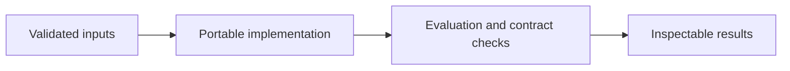

# Agentic Project Orchestration

**Feras Elghandour** · Technical case study

Turn an unstructured product request into routed, evaluated, and actionable project deliverables.

## Implementation

A provider-neutral orchestration core with embedding-based routing, bounded revision loops, typed reviewer decisions, and staged project artifacts.



## Completed study

The source implements bounded evaluation loops and explicit handling of invalid evaluator decisions. The release provides offline contract checks; historical provider transcripts are not used to claim a general task-success rate.

These historical figures describe the completed study. This refactored standalone implementation has separate validation and has not been used to recertify the historical benchmark. The public release contains the portable core and focused tests.

## Run locally

Python 3.11 or later.

```sh
python -m venv .venv
source .venv/bin/activate
python -m pip install -r requirements.txt
python smoke_test.py
python smoke_test.py
```

Prepare your own inputs as described in [DATA.md](DATA.md). Tests use generated fixtures and do not need credentials or provider calls. [VALIDATION.md](VALIDATION.md) records their scope.

## Practical relevance and limitations

Routing quality and evaluator judgments depend on the selected models and prompts. Live runs require a configured OpenAI-compatible provider. No client delivery, autonomous operational deployment, or business impact is claimed.

This edition makes the core behavior reusable and inspectable. Historical metrics and synthetic contract tests provide different kinds of evidence; neither establishes client deployment or commercial impact.
