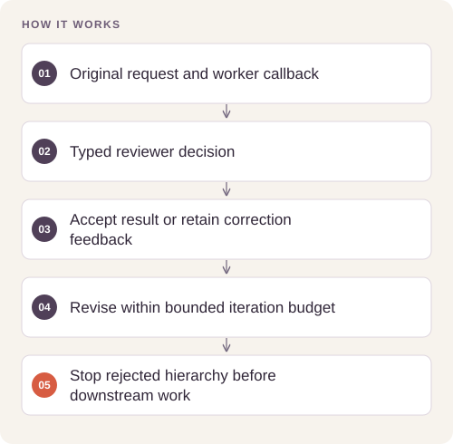

# Agentic Project Orchestration

Turn an unstructured product request into routed, evaluated, and actionable project deliverables.

## Implementation

A provider-neutral orchestration core with embedding-based routing, bounded revision loops, typed reviewer decisions, and staged project artifacts.




## Reproduce and inspect

The executable reproduction profile now records exact commands, input/source hashes, dependency versions, logs and pass/fail status. Its scope distinguishes behavior checks from full-data benchmarks.

[Commands, artifacts and benchmark scope](BENCHMARKS.md) · [Versioned profiles](reproduction.json)


## Try a small example

A small offline fixture exercises the public implementation. It demonstrates the behavior shown below; it does not replace the historical dataset, benchmark or production validation.

After the local setup below, run from the repository root:

```sh
python examples/quickstart.py
```

The [example source](examples/quickstart.py), [captured output](examples/expected-output.txt) and [execution record](examples/environment.json) keep this demonstration inspectable. Floating-point values may vary with library versions.

Observed output from this run:

```text
{
  "response": "ready",
  "accepted": true,
  "attempts": 2,
  "history": [
    {
      "attempt": 1,
      "response": "draft",
      "accepted": false,
      "feedback": "Return ready"
    },
    {
      "attempt": 2,
      "response": "ready",
      "accepted": true,
      "feedback": "Return ready"
    }
  ]
}
```

## Completed study

The source implements bounded evaluation loops and explicit handling of invalid evaluator decisions. The release provides offline contract checks; historical provider transcripts are not used to claim a general task-success rate.

These historical figures describe the completed study. This refactored standalone implementation has separate validation and has not been used to recertify the historical benchmark. The public release contains the portable core and focused tests.

## Run locally

Python 3.11 or later.

```sh
python -m venv .venv
source .venv/bin/activate
python -m pip install -r requirements.txt
python smoke_test.py
```

Prepare your own inputs as described in [DATA.md](DATA.md). Tests use generated fixtures and do not need credentials or provider calls. [VALIDATION.md](VALIDATION.md) records their scope.

## Practical relevance and limitations

Routing quality and evaluator judgments depend on the selected models and prompts. Live runs require a configured OpenAI-compatible provider. No client delivery, autonomous operational deployment, or business impact is claimed.
